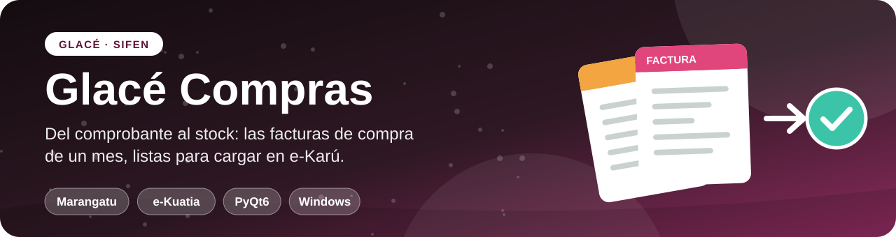
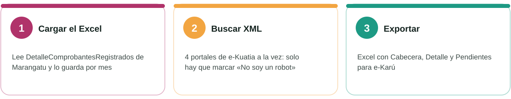
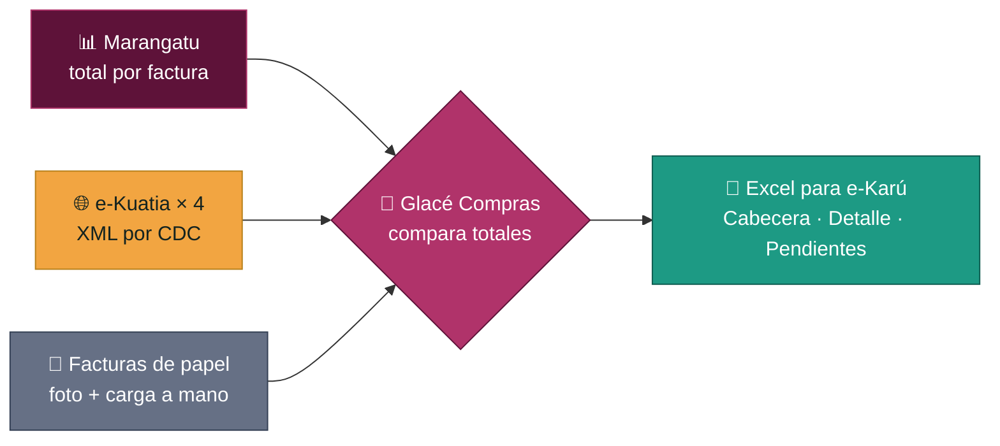
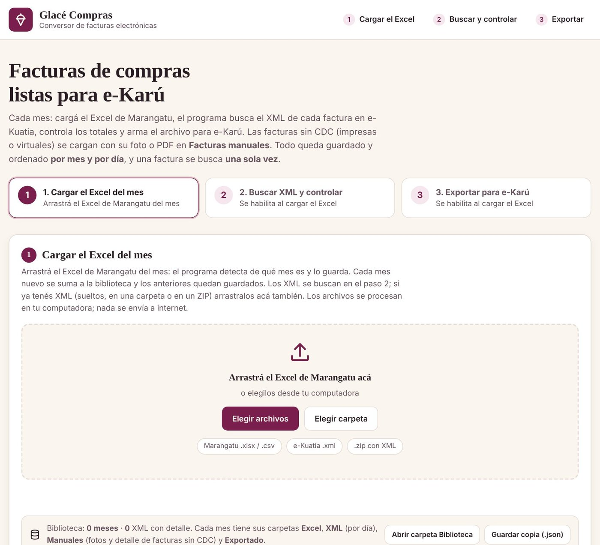
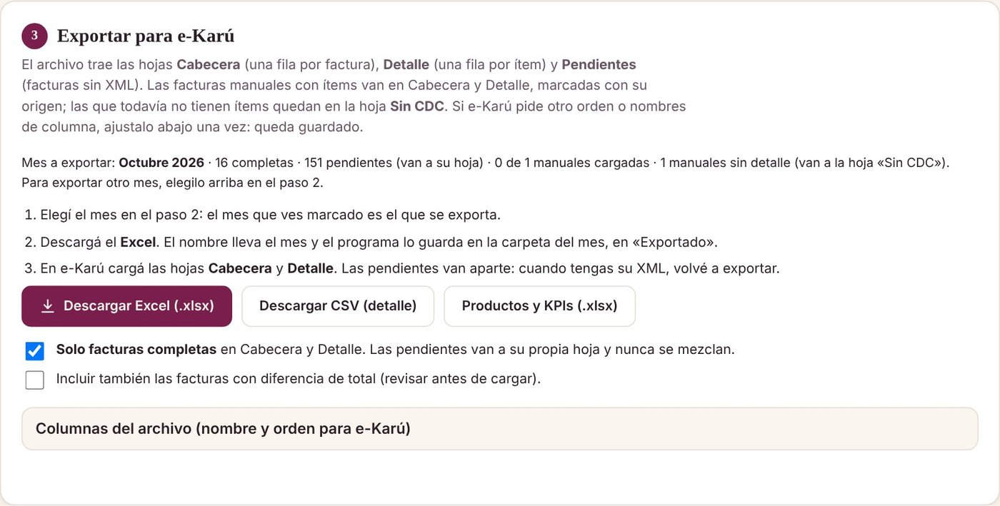

### 🔀 De tres fuentes a un solo archivo

## 😩 El problema

e-Karú necesita el **detalle** de cada compra (producto, cantidad, precio), pero Marangatu solo da el total por factura, el XML de cada factura hay que bajarlo uno por uno en e-Kuatia (con captcha), y las facturas de papel no tienen CDC.

## 💡 La solución, en tres pasos

| Paso | Qué hace el programa |
|---|---|
| **1 · Cargar el Excel del mes** | Lee «DetalleComprobantesRegistrados» de Marangatu y lo guarda por mes |
| **2 · Buscar XML y controlar** | Abre **4 portales de e-Kuatia a la vez**: la persona solo marca «No soy un robot»; el programa escribe la CDC, consulta, descarga el XML y compara el total con Marangatu |
| **3 · Exportar para e-Karú** | Un Excel con hojas Cabecera, Detalle y Pendientes; las facturas de papel se cargan a mano con foto |

## 🚀 Empezar (Windows)

1. Instalar Python 3 y marcar **«Add python.exe to PATH»**.
2. Doble clic en **`Iniciar_Glace_Compras.bat`**. La primera vez instala PyQt6 y PyQt6-WebEngine (~150 MB) y crea el acceso directo «Glace Compras» en el escritorio.

## 📁 Archivos

| Archivo | Para qué |
|---|---|
| `Glace_Compras_App.pyw` | Ventana principal y automatización de los 4 portales |
| `Glace_Compras.html` | Interfaz: meses, proveedores, facturas manuales, exportación |
| `ek_helpers.js` | Funciones que se inyectan en el portal de e-Kuatia |
| `tools/selftest.pyw` | Prueba automática del programa (`tools/Probar.bat`) |
| `docs/` | Documento del sistema y resultados de la encuesta al personal de caja |

> [!CAUTION]
> 🔒 Los datos reales (Excel de Marangatu, XML de facturas, log) **no** se suben: están en `.gitignore`.

Parte de: [ekaru-procesos](https://github.com/alvaroliuzzi-bot/ekaru-procesos) · [ekaru-etiquetas](https://github.com/alvaroliuzzi-bot/ekaru-etiquetas) · [paginas-web](https://github.com/alvaroliuzzi-bot/paginas-web)

